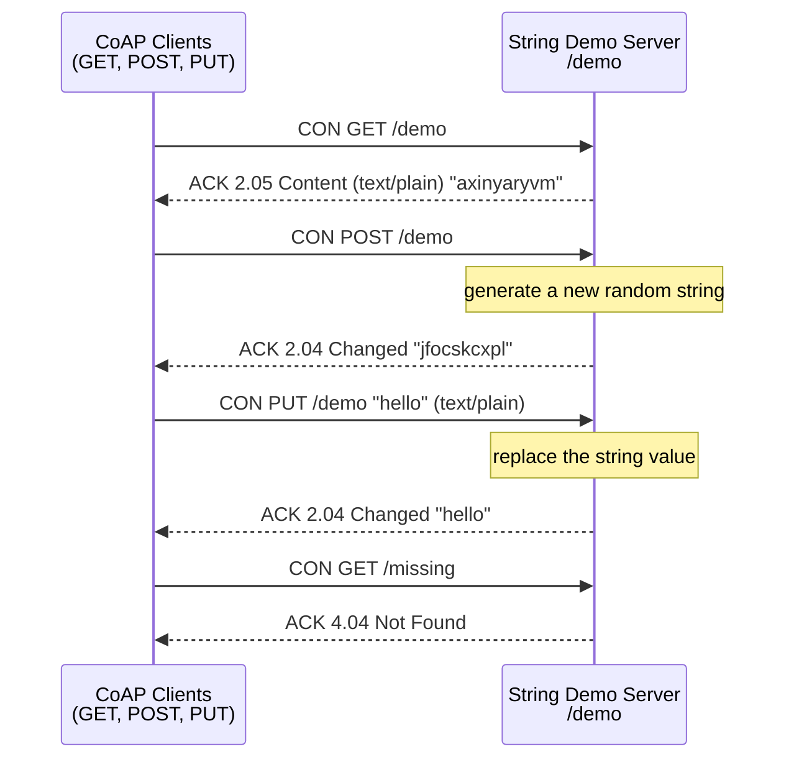
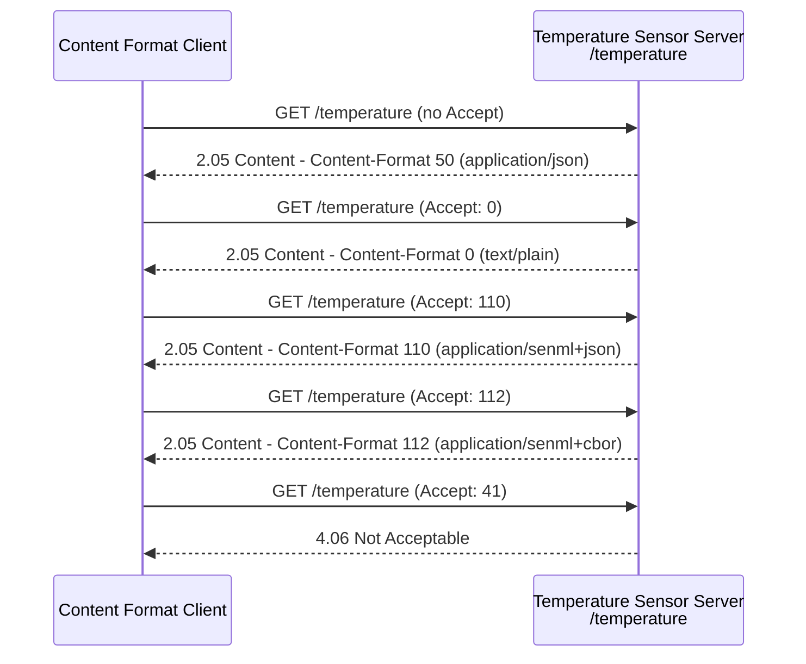
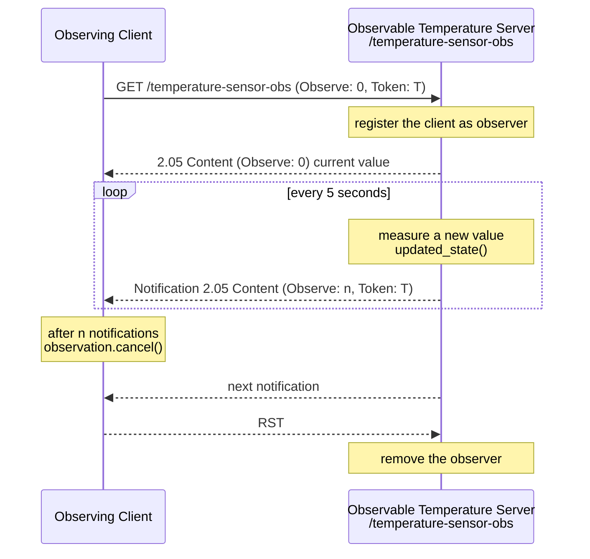
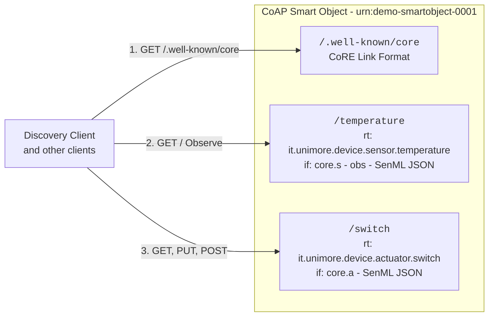
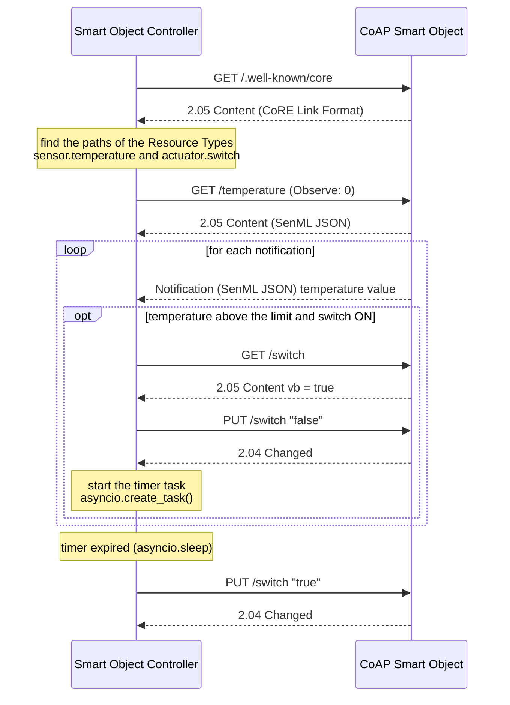
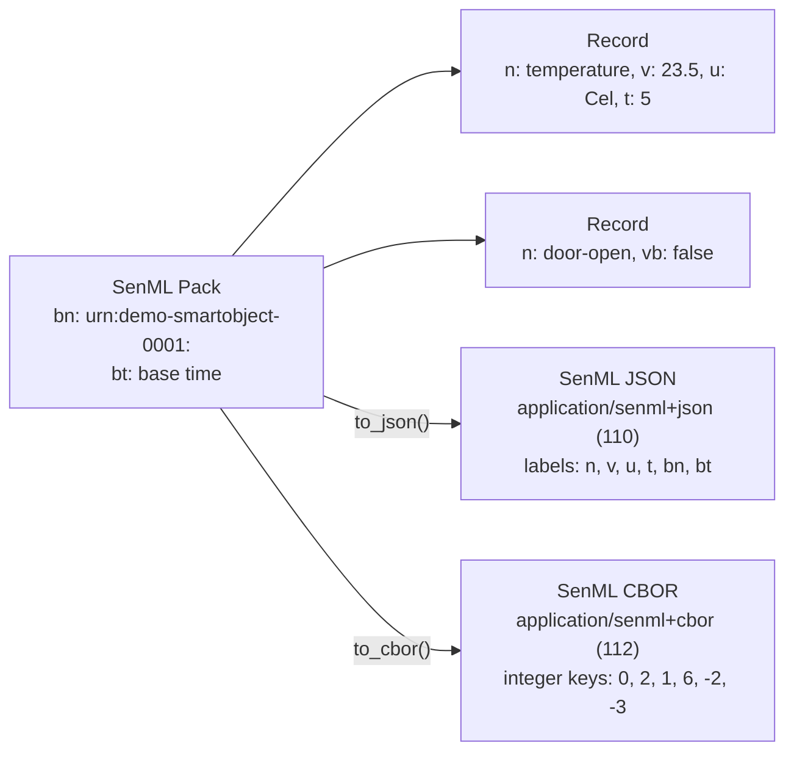

# Python CoAP Playground

This Project contains a group of Python CoAP examples based on the aiocoap library focusing on the following aspects:

- Simple CoAP Server and Clients (GET, POST and PUT)
- Content Format Negotiation (JSON, Text, SenML JSON and SenML CBOR)
- CoAP Observe (Observable Resources and Observing Clients)
- CoAP Resource Discovery with the CoRE Link Format (`/.well-known/core`)
- CoAP IoT Smart Object and an autonomous Controller
- SenML (Sensor Measurement Lists) data format

Reference CoAP Python Library aiocoap (0.4.x) - https://github.com/chrysn/aiocoap

## Table of Contents

- [Setup](#setup)
  - [Using pip (alternative)](#using-pip-alternative)
  - [CoAP Server & Network](#coap-server--network)
- [Configuration](#configuration)
- [aiocoap 0.4.x](#aiocoap-04x)
- [Asynchronous Model of aiocoap](#asynchronous-model-of-aiocoap)
  - [The Event Loop](#the-event-loop)
  - [Starting a Server](#starting-a-server)
  - [Sending a Request](#sending-a-request)
  - [Never Block the Event Loop](#never-block-the-event-loop)
- [Project Structure](#project-structure)
  - [Type Hints](#type-hints)
- [Running the Examples](#running-the-examples)
- [Playground Outline](#playground-outline)
  - [1. String Demo Server & Clients](#1-string-demo-server--clients)
  - [2. Temperature Sensor & Content Format Negotiation](#2-temperature-sensor--content-format-negotiation)
  - [3. CoAP Observe](#3-coap-observe)
  - [4. CoAP Smart Object & Resource Discovery](#4-coap-smart-object--resource-discovery)
  - [5. Smart Object Controller](#5-smart-object-controller)
  - [6. SenML Data Format](#6-senml-data-format)
- [CoAP Client Tools](#coap-client-tools)
  - [aiocoap-client](#aiocoap-client)
  - [Wireshark](#wireshark)

## Setup

The project is managed with [uv](https://docs.astral.sh/uv/). Dependencies are declared in `pyproject.toml`,
locked in `uv.lock`, and the Python version (3.12) is pinned in `.python-version`.

- Dependencies:
  - `aiocoap` (0.4.x): CoAP library based on `asyncio`
  - `LinkHeader`: parsing of the CoRE Link Format (used by aiocoap and by the discovery clients)
  - `kpn-senml`: creation and parsing of SenML payloads in JSON and CBOR
  - `cbor2`: CBOR encoding and decoding (used by `kpn-senml` and by the content format client)
  - `pyyaml`: to read the configuration file

Install uv (if needed) following the [official instructions](https://docs.astral.sh/uv/getting-started/installation/), e.g.:

```bash
curl -LsSf https://astral.sh/uv/install.sh | sh
```

Then, from the project root, create the virtual environment (`.venv`) and install all the dependencies with:

```bash
uv sync
```

uv automatically downloads the required Python version if it is not available on your machine.
The command also installs the `coap_playground` package (in `src/`) in editable mode, together with a dedicated
command for each CoAP server and client (see [Running the Examples](#running-the-examples)).

In PyCharm, you can select the existing `.venv` interpreter or add a new "uv" interpreter from the interpreter settings.

### Using pip (alternative)

The `requirements.txt` file is **generated** from `uv.lock` and is kept only for pip-based workflows:

```bash
pip install -r requirements.txt
```

Do not edit it manually. After changing the dependencies, regenerate it with:

```bash
uv export --no-hashes --no-dev -o requirements.txt
```

### CoAP Server & Network

Differently from MQTT, CoAP does not require an external broker: each IoT device runs its own **CoAP Server**
that exposes its resources, and the clients send requests directly to it.
All the servers of the playground run on your machine and listen on the default CoAP port (`5683`) over **UDP**.

Keep in mind that:

- **only one server at a time** can listen on the same port: stop the running server (`CTRL+C`) before starting another
  one, or change the port in `config.yaml`;
- the servers listen on `127.0.0.1` by default, so they accept only local requests. To reach a server from another
  device (e.g., a classmate's laptop on the same network), set `bind_host: 0.0.0.0` in the server configuration and the
  IP address of the server machine in the client configuration;
- CoAP uses UDP: firewalls and some Wi-Fi networks (e.g., guest networks) can block the traffic between different hosts,
  while the local communication on `127.0.0.1` always works.

## Configuration

The parameters shared by all the scripts are defined in the `config.yaml` file in the project root:

```yaml
# CoAP Servers (process/ folder)
server:
  bind_host: 127.0.0.1
  port: 5683

# CoAP Clients (client/ folder)
client:
  server_host: 127.0.0.1
  server_port: 5683
```

The file is read by the `ConfigManager` class (`src/coap_playground/config/config_manager.py`), that searches it in the
current working directory and then in the project root. Each process creates its own `ConfigManager` in `main()`
and reads the parameters through its properties (e.g., `config_manager.server_port`).
The clients use the `build_server_uri()` method to build the complete URI of a resource, e.g.:

```python
config_manager = ConfigManager()
config_manager.build_server_uri("temperature")   # coap://127.0.0.1:5683/temperature
```

The parameters specific to each example (resource paths, device name, update period, ...) are defined as
configuration variables at the beginning of each module.

## aiocoap 0.4.x

[aiocoap](https://aiocoap.readthedocs.io/) is a Python implementation of CoAP (RFC 7252) and of its main extensions
(Observe - RFC 7641, Block-wise transfers - RFC 7959, CoRE Link Format - RFC 6690, OSCORE, ...).
The playground uses the following building blocks:

| Element                               | Description                                                                                      |
|---------------------------------------|--------------------------------------------------------------------------------------------------|
| `aiocoap.Context`                     | The CoAP endpoint: it manages the UDP socket, message ids, tokens, retransmissions and Observe    |
| `aiocoap.Message`                     | A CoAP message (request or response) with `code`, `uri`, `payload` and options (`opt`)           |
| `aiocoap.resource.Site`               | The root of the resource tree: it dispatches each request to the resource registered on its path |
| `aiocoap.resource.Resource`           | Base class of a resource: implement `render_get()`, `render_post()`, `render_put()`, ...          |
| `aiocoap.resource.ObservableResource` | Base class of an observable resource: call `updated_state()` to notify all the observers         |
| `aiocoap.resource.WKCResource`        | The `/.well-known/core` resource that describes all the resources of a `Site` (CoRE Link Format) |
| `aiocoap.numbers.ContentFormat`       | The registry of the Content-Formats (e.g., `ContentFormat.JSON` = 50, `ContentFormat.TEXT` = 0)  |
| `aiocoap.GET`, `aiocoap.CHANGED`, ... | Method and response codes (e.g., `aiocoap.BAD_REQUEST` = 4.00, `aiocoap.NOT_ACCEPTABLE` = 4.06)  |

A resource receives the request as an `aiocoap.Message` and returns the response as another `aiocoap.Message`:

```python
import aiocoap
import aiocoap.resource as resource
from aiocoap.numbers import ContentFormat


class StringDemoResource(resource.Resource):

    async def render_get(self, request: aiocoap.Message) -> aiocoap.Message:
        # No code: aiocoap uses 2.05 Content for GET (and 2.04 Changed for POST and PUT)
        return aiocoap.Message(content_format=ContentFormat.TEXT, payload="hello".encode("utf-8"))

    async def render_put(self, request: aiocoap.Message) -> aiocoap.Message:
        new_value = request.payload.decode("utf-8")
        return aiocoap.Message(code=aiocoap.CHANGED)
```

If a resource does not implement a method (e.g., `render_delete()`), aiocoap automatically responds with
`4.05 Method Not Allowed`, while a request to a path without a resource receives `4.04 Not Found`.

The payload of a CoAP message is always an array of **bytes**: strings must be encoded (`encode("utf-8")`) before
sending them and decoded (`decode("utf-8")`) after receiving them.

## Asynchronous Model of aiocoap

### The Event Loop

aiocoap is based on [asyncio](https://docs.python.org/3/library/asyncio.html), the Python framework for asynchronous
programming. Instead of using a thread for each request, all the operations are executed by a single **event loop**
as `async` functions (coroutines). When a coroutine waits for something (e.g., a response from the network) it
uses `await`: the coroutine is suspended and the event loop can execute other coroutines in the meantime
(e.g., serving another request or sending a notification to an observer).

Each process of the playground follows the same structure: an `async` function contains the CoAP logic, and the
synchronous `main()` function starts it with `asyncio.run()`, that creates the event loop, runs the coroutine until it
completes and closes the loop.

```python
async def run_server(config_manager: ConfigManager) -> None:
    ...

def main() -> None:
    config_manager = ConfigManager()
    asyncio.run(run_server(config_manager))
```

### Starting a Server

A server creates the resource tree, binds the server context to the configured address and then waits forever.
The requests are served by the event loop while `run_server()` is suspended on a `Future` that is never completed:

```python
async def run_server(config_manager: ConfigManager) -> None:

    root = resource.Site()
    root.add_resource(["demo"], StringDemoResource())

    # The server is ready to receive requests when the await returns
    await aiocoap.Context.create_server_context(root, bind=(config_manager.server_bind_host, config_manager.server_port))

    # Wait forever (CTRL+C to stop the process)
    await asyncio.get_running_loop().create_future()
```

### Sending a Request

A client creates a client context, sends the request and waits for the response. `context.request()` returns
immediately, while `await ... .response` suspends the coroutine until the response arrives. In the meantime aiocoap
manages the retransmissions of the Confirmable (CON) request if the ACK is not received:

```python
async def send_get_request(config_manager: ConfigManager, resource_path: str) -> None:

    context = await aiocoap.Context.create_client_context()

    request = aiocoap.Message(code=aiocoap.GET, uri=config_manager.build_server_uri(resource_path))

    try:
        response = await context.request(request).response
        print(response.code, response.payload.decode("utf-8"))
    finally:
        await context.shutdown()
```

### Never Block the Event Loop

Since everything runs in a single event loop, a blocking call (e.g., `time.sleep(5)` or a long computation) inside a
coroutine stops the whole process: a server would not answer any request until the call returns.
For this reason, the observable resources emulate the periodic measurements of the sensor with a **background task**
that uses the non-blocking `await asyncio.sleep()`:

```python
def start_measurements(self) -> None:
    # asyncio.create_task() requires a running event loop: it is called in run_server(), after the server creation
    self.measurement_task = asyncio.create_task(self.measurement_loop())

async def measurement_loop(self) -> None:
    while True:
        await asyncio.sleep(self.update_period_s)   # the loop keeps serving requests in the meantime
        self.temperature_sensor.measure_temperature()
        self.updated_state()                        # notify all the observers
```

The same approach replaces the MQTT `threading.Timer` in the [Smart Object Controller](#5-smart-object-controller):
the delayed action is a coroutine started with `asyncio.create_task()`, that waits with `asyncio.sleep()` and then sends
the request, while the main coroutine keeps receiving the notifications.

## Project Structure

The project follows the `src` layout: all the code is in the `coap_playground` package in `src/`.

```
python-coap-playground/
├── pyproject.toml          # Project metadata, dependencies and entry points
├── uv.lock                 # Locked dependency versions (managed by uv)
├── requirements.txt        # Generated from uv.lock for pip users
├── config.yaml             # Shared configuration (servers and clients)
└── src/coap_playground/    # Application package
    ├── config/             # ConfigManager (reads config.yaml)
    ├── dto/                # Data Transfer Objects (JSON payloads)
    ├── model/              # Emulated sensors and actuators
    ├── resources/          # CoAP resources (aiocoap Resource and ObservableResource classes)
    ├── process/            # CoAP servers, each with a main() function
    ├── client/             # CoAP clients, each with a main() function
    └── senml/              # SenML examples
```

Each module in `process/` and `client/` follows the same structure:

- the **configuration variables** of the example (resource paths, device name, ...) at the beginning of the module;
- an **`async` function** with the CoAP logic (`run_server()` for the servers, e.g., `send_get_request()` for the clients),
  that receives the `ConfigManager` (and the other values) as parameters instead of using global variables;
- the **`main()`** function that loads the configuration and starts the async function with `asyncio.run()`.

The resources in `resources/` are independent of the server that uses them: a server is just a resource tree
(`Site`) where the resources are registered on their paths. Importing a module has no side effects: the process starts
only when `main()` is called.

### Type Hints

The code uses Python **type hints** (Python >= 3.10 syntax, e.g., `float | str`, `ContentFormat | None`) on DTOs,
Models, Resources, the `ConfigManager` and the functions of the processes. The `render_*()` methods of the resources
receive and return an `aiocoap.Message`:

```python
async def render_get(self, request: aiocoap.Message) -> aiocoap.Message:
    ...
```

Type hints are not checked at runtime by Python. To check the code with [mypy](https://mypy.readthedocs.io/) run:

```bash
uv run --with mypy mypy src/coap_playground --ignore-missing-imports
```

## Running the Examples

Each process is exposed as a command declared in the `[project.scripts]` section of `pyproject.toml`:

| Command                         | Module                                                  |
|---------------------------------|---------------------------------------------------------|
| `string-demo-server`            | `coap_playground.process.string_demo_server`            |
| `temperature-sensor-server`     | `coap_playground.process.temperature_sensor_server`     |
| `obs-temperature-sensor-server` | `coap_playground.process.obs_temperature_sensor_server` |
| `smart-object-server`           | `coap_playground.process.smart_object_server`           |
| `coap-get-client`               | `coap_playground.client.coap_get_client`                |
| `coap-post-client`              | `coap_playground.client.coap_post_client`               |
| `coap-put-client`               | `coap_playground.client.coap_put_client`                |
| `coap-content-format-client`    | `coap_playground.client.coap_content_format_client`     |
| `coap-observe-client`           | `coap_playground.client.coap_observe_client`            |
| `coap-discovery-client`         | `coap_playground.client.coap_resource_discovery_client` |
| `smart-object-controller`       | `coap_playground.client.smart_object_controller`        |
| `senml-demo`                    | `coap_playground.senml.senml_demo`                      |

From the project root, start a server in a terminal and then the clients in another terminal with `uv run`, e.g.:

```bash
uv run string-demo-server
uv run coap-get-client
```

The generic clients accept the path of the target resource (and, for PUT, the payload) as arguments, so the same client
can be used with all the servers:

```bash
uv run coap-get-client temperature
uv run coap-put-client switch false
uv run coap-observe-client temperature
```

Alternatively, you can run a process as a module or execute the file directly:

```bash
uv run python -m coap_playground.process.string_demo_server
uv run src/coap_playground/process/string_demo_server.py
```

---

## Playground Outline

- [String Demo Server & Clients](#1-string-demo-server--clients)
- [Temperature Sensor & Content Format Negotiation](#2-temperature-sensor--content-format-negotiation)
- [CoAP Observe](#3-coap-observe)
- [CoAP Smart Object & Resource Discovery](#4-coap-smart-object--resource-discovery)
- [Smart Object Controller](#5-smart-object-controller)
- [SenML Data Format](#6-senml-data-format)

### 1. String Demo Server & Clients



In this exercise, we create a minimal CoAP Server exposing a single resource (`/demo`) whose state is a simple string,
and a set of clients to interact with it using the main CoAP methods.

The resource is modeled by the `StringDemoResource` class, that extends `aiocoap.resource.Resource` and implements
one `render_<method>()` coroutine for each supported method. The server creates a `Site` (the resource tree),
registers the resource on the path `["demo"]` and starts listening on UDP port `5683`.

- **Python Files**:
  - `src/coap_playground/resources/string_demo_resource.py`: the `/demo` resource
  - `src/coap_playground/process/string_demo_server.py` (`uv run string-demo-server`)
  - `src/coap_playground/client/coap_get_client.py` (`uv run coap-get-client`)
  - `src/coap_playground/client/coap_post_client.py` (`uv run coap-post-client`)
  - `src/coap_playground/client/coap_put_client.py` (`uv run coap-put-client demo <new_value>`)

- **CoAP Resource `/demo`**:

| Method | Request Payload | Behavior                                     | Response                              |
|--------|-----------------|----------------------------------------------|---------------------------------------|
| GET    | -               | Read the current string                      | `2.05 Content` + `text/plain` payload |
| POST   | -               | Generate a new random string                 | `2.04 Changed` + the new value        |
| PUT    | `text/plain`    | Replace the string with the received payload | `2.04 Changed` + the new value        |
| DELETE | -               | Not implemented                              | `4.05 Method Not Allowed` (automatic) |

- **Clients**:
  - Create a client context, build the request with the URI `coap://<server_host>:<server_port>/demo` and send it
    as a Confirmable message.
  - Print the response code, the Content-Format and the payload (as bytes and as a decoded string).
  - Try also a path that does not exist (e.g., `uv run coap-get-client missing`) to receive `4.04 Not Found`.

> **POST vs PUT**: PUT is idempotent and replaces the state of the target resource with the payload of the request,
> while POST asks the resource to process the request (e.g., trigger an action). `2.01 Created` should be used only
> when a POST creates a new resource, while `2.04 Changed` is used when the state of an existing resource changes.

### 2. Temperature Sensor & Content Format Negotiation



The same resource can be represented in different formats. In CoAP, the **Content-Format** option of a response
declares the format of its payload with a numeric identifier (from the IANA CoAP Content-Formats registry), while
the client can select its preferred format with the **Accept** option of the request.

The `/temperature` resource of this server measures a new random value at each GET request and supports four
representations. If the client does not send the Accept option, the server uses `application/json`, while if
the requested format is not supported the server answers with `4.06 Not Acceptable`.

| Content-Format           | Id    | Example Payload                                                                    |
|--------------------------|-------|------------------------------------------------------------------------------------|
| `text/plain`             | `0`   | `26.47`                                                                            |
| `application/json`       | `50`  | `{"timestamp": 1730000000, "value_type": "TEMPERATURE_SENSOR", "value": 26.47}`    |
| `application/senml+json` | `110` | `[{"n": "temperature", "v": 26.47, "t": 1730000000, "u": "Cel", "bn": "urn:..."}]` |
| `application/senml+cbor` | `112` | binary (the same SenML Records encoded in CBOR)                                    |

- **Python Files**:
  - `src/coap_playground/model/temperature_sensor.py`: emulated temperature sensor (random values between 20 and 40)
  - `src/coap_playground/dto/message_descriptor.py`: JSON representation (`timestamp`, `value_type`, `value`)
  - `src/coap_playground/resources/temperature_sensor_resource.py`: the `/temperature` resource
  - `src/coap_playground/process/temperature_sensor_server.py` (`uv run temperature-sensor-server`)
  - `src/coap_playground/client/coap_content_format_client.py` (`uv run coap-content-format-client`)

- **Temperature Sensor Server**:
  - Expose the `/temperature` resource supporting only the GET method.
  - Read the Accept option of the request (`request.opt.accept`, `None` if not present) and build the payload
    in the requested format, setting the corresponding Content-Format option in the response.
  - Answer `4.06 Not Acceptable` if the requested format is not supported.

- **Content Format Client**:
  - Send a sequence of GET requests to `/temperature`, each one with a different Accept option
    (none, JSON, text, SenML JSON, SenML CBOR and the unsupported `application/xml`).
  - Print the response code, the Content-Format and the size of each payload: compare the size of the
    SenML JSON and SenML CBOR representations of the same data.
  - The CBOR payload is binary and can not be decoded as UTF-8: the client decodes it with the `cbor2` library.

```python
request = aiocoap.Message(code=aiocoap.GET, uri=target_uri)
request.opt.accept = ContentFormat.by_media_type("application/senml+cbor")
```

### 3. CoAP Observe



With a traditional request/response interaction a client has to poll the server to know if the state of a resource has
changed. The **Observe** extension (RFC 7641) allows a client to register as **observer** of a resource and to receive
a **notification** from the server every time its state changes, without sending new requests.

- The client sends a GET request with the **Observe option set to `0`** (register).
- The server answers with the current representation (with the Observe option, meaning that the registration has been
  accepted) and then sends a notification at each change, with an increasing value of the Observe option that allows
  the client to order the notifications (UDP does not guarantee the order of delivery).
- The client cancels the observation (Observe = `1`, or with a Reset message to the next notification).
  In aiocoap `observation.cancel()` is local: the client stops accepting the notifications and answers the next
  one with a Reset (RST), so the server removes it from the observers (the server prints `Number of active observers: 0`).

In aiocoap an observable resource extends `ObservableResource` and calls `self.updated_state()` when its state changes:
the library calls `render_get()` for each registered observer and sends the notification.
The `ObsTemperatureSensorResource` uses a background asyncio task (see [Never Block the Event Loop](#never-block-the-event-loop))
to measure a new temperature value every 5 seconds and notify the observers.

- **Python Files**:
  - `src/coap_playground/resources/obs_temperature_sensor_resource.py`: the observable `/temperature-sensor-obs` resource
  - `src/coap_playground/process/obs_temperature_sensor_server.py` (`uv run obs-temperature-sensor-server`)
  - `src/coap_playground/client/coap_observe_client.py` (`uv run coap-observe-client`)

- **Observable Temperature Server**:
  - Expose the `/temperature-sensor-obs` resource (JSON representation).
  - Start the periodic measurement task after the creation of the server context (it requires a running event loop).
  - At each new measurement call `updated_state()` to notify all the observers.
  - Print the number of active observers through the `update_observation_count()` hook.

- **Observing Client**:
  - Send a GET request with `observe=0` and print the first response.
  - Iterate over the notifications with `async for notification in observation_request.observation`.
  - After `n` notifications (e.g., 10) cancel the observation with `observation_request.observation.cancel()`.

```python
request = aiocoap.Message(code=aiocoap.GET, uri=target_uri, observe=0)
observation_request = context.request(request)

first_response = await observation_request.response

async for notification in observation_request.observation:
    print(notification.opt.observe, notification.payload.decode("utf-8"))
```

Start more observing clients at the same time to see how the server notifies all of them with a single `updated_state()`.

### 4. CoAP Smart Object & Resource Discovery



In a real IoT deployment a client often does not know in advance which resources are exposed by a device and on which
paths. **CoAP Resource Discovery** solves this problem with a standard resource, `/.well-known/core`, that returns the
list of the resources of the server described with the **CoRE Link Format** (RFC 6690, Content-Format `40`):

```
</.well-known/core>;ct="40",
</temperature>;ct="110";rt="it.unimore.device.sensor.temperature";if="core.s";obs;title="Temperature Sensor",
</switch>;ct="110";rt="it.unimore.device.actuator.switch";if="core.a";title="Switch Actuator"
```

Each link contains the path of the resource and a set of attributes describing it:

| Attribute | Meaning                    | Example                                                                          |
|-----------|----------------------------|----------------------------------------------------------------------------------|
| `rt`      | Resource Type              | `it.unimore.device.sensor.temperature`: the semantic type (application specific) |
| `if`      | Interface Description      | `core.s` (sensor), `core.a` (actuator), from the CoRE Interfaces draft           |
| `ct`      | Content-Format             | `110` (`application/senml+json`)                                                 |
| `obs`     | Observable                 | present only if the resource supports Observe                                    |
| `title`   | Human readable description | `Temperature Sensor`                                                             |

The client can also filter the list with a query string on any attribute, e.g., `/.well-known/core?rt=it.unimore.device.actuator.switch`
or `/.well-known/core?if=core.s`.

This example emulates an IoT **Smart Object** with an observable temperature sensor and a switch actuator, both
returning SenML JSON payloads. In aiocoap the attributes are defined as fields of the resource (`self.rt`, `self.if_`,
`self.ct`, plus `obs` added automatically by `ObservableResource`), while the `title` is added by overriding
`get_link_description()`. The `WKCResource` registered on `/.well-known/core` builds the description of all the
resources of the `Site`:

```python
root.add_resource([".well-known", "core"], resource.WKCResource(root.get_resources_as_linkheader, impl_info=None))
root.add_resource(["temperature"], CoreTemperatureSensorResource(device_name))
root.add_resource(["switch"], CoreSwitchActuatorResource(device_name))
```

- **Python Files**:
  - `src/coap_playground/model/switch_actuator.py`: emulated switch actuator
  - `src/coap_playground/resources/core_temperature_sensor_resource.py`: observable temperature sensor (`core.s`)
  - `src/coap_playground/resources/core_switch_actuator_resource.py`: switch actuator (`core.a`)
  - `src/coap_playground/process/smart_object_server.py` (`uv run smart-object-server`)
  - `src/coap_playground/client/coap_resource_discovery_client.py` (`uv run coap-discovery-client [query]`)

- **CoAP Smart Object**:
  - `/temperature`: GET (SenML JSON), observable with a new measurement every 5 seconds.
  - `/switch`: GET (SenML JSON with the boolean value `vb`), PUT with a `true`/`false` plain text payload to set the
    status (`4.00 Bad Request` for any other payload), POST without payload to toggle the status.
  - `/.well-known/core`: CoRE Link Format description of the resources.

- **Discovery Client**:
  - Send a GET request to `/.well-known/core` (optionally with a query filter passed as argument).
  - Parse the response with the `LinkHeader` library and print the path and the attributes of each resource.

```bash
uv run coap-discovery-client
uv run coap-discovery-client if=core.a
uv run coap-get-client switch
uv run coap-put-client switch false
uv run coap-post-client switch
```

### 5. Smart Object Controller



The controller is an autonomous client that interacts with the Smart Object **without knowing the paths of its
resources**, relying only on their Resource Types. It is the CoAP version of the MQTT Smart Object Controller, where
the subscription to the telemetry topic is replaced by the observation of the sensor resource and the publication on
the action topic is replaced by a PUT request to the actuator resource.

- **Python Files**:
  - `src/coap_playground/client/smart_object_controller.py` (`uv run smart-object-controller`)

- **Smart Object Controller**:
  - Discover the resources through `/.well-known/core` and look for the expected Resource Types
    (`it.unimore.device.sensor.temperature` and `it.unimore.device.actuator.switch`). Stop if they are not available.
  - Observe the temperature sensor and read the value of each SenML notification.
  - When the temperature is above a limit (e.g., `37` °C) and the switch is `ON`, send a PUT request to switch it `OFF`.
  - Start a timer (an asyncio task) to switch the actuator `ON` again after a delay (e.g., 10 seconds),
    while the main coroutine keeps receiving the notifications.
  - Cancel the observation after `n` notifications.

Start the `smart-object-server` and then the `smart-object-controller`. In another terminal you can check the status
of the switch with `uv run coap-get-client switch` while the controller is running.

### 6. SenML Data Format



**SenML** (Sensor Measurement Lists, RFC 8428) is a standard data model to represent sensor measurements and device
parameters, widely used together with CoAP. A SenML **Pack** is a list of **Records**: each Record has a name (`n`),
a value and optional time (`t`) and unit (`u`), while the **base fields** (`bn`, `bt`, `bu`, ...) apply to all the
following Records and avoid repeating the same information.

| Field        | Label | CBOR Key | Description                                                  |
|--------------|-------|----------|--------------------------------------------------------------|
| Base Name    | `bn`  | `-2`     | Prefix of the name of all the Records (e.g., the device id)  |
| Base Time    | `bt`  | `-3`     | Absolute time added to the time of all the Records           |
| Name         | `n`   | `0`      | Name of the measurement (full name = `bn` + `n`)             |
| Unit         | `u`   | `1`      | Unit from the SenML Units registry (e.g., `Cel`, `%RH`, `W`) |
| Value        | `v`   | `2`      | Numeric value                                                |
| String Value | `vs`  | `3`      | String value                                                 |
| Bool Value   | `vb`  | `4`      | Boolean value                                                |
| Time         | `t`   | `6`      | Time of the measurement (relative to `bt` if present)        |

The same Pack can be serialized in JSON (`application/senml+json`) or in the more compact binary CBOR
(`application/senml+cbor`), where the labels are replaced by integer keys.

- **Python Files**:
  - `src/coap_playground/senml/senml_demo.py` (`uv run senml-demo`, no server required)

- **SenML Demo**:
  - Build a Pack with a Base Name, a Base Time and two Records (numeric value with unit and boolean value).
  - Serialize it in JSON and CBOR and compare the size of the two payloads.
  - Parse both payloads: `kpn-senml` calls a callback for each Record found (the same mechanism used to deliver the
    commands received by an actuator).

```python
pack = SenmlPack("urn:demo-smartobject-0001:")
pack.add(SenmlRecord("temperature", unit=SenmlUnits.SENML_UNIT_DEGREES_CELSIUS, value=23.5))
pack.add(SenmlRecord("door-open", value=False))

json_payload = pack.to_json()
cbor_payload = pack.to_cbor()
```

> **kpn-senml 1.0.1 limitations**: the library expects **absolute** times on the Records and serializes them relative
> to the Base Time (a measurement 5 seconds after `bt` has `t = 5`), and string values (`vs`) raise a
> `NameError: name 'basestring' is not defined` on Python 3. The playground uses only numeric and boolean values.

## CoAP Client Tools

Besides the clients of the playground, it is useful to interact with the CoAP servers through external tools,
to send custom requests and to analyze the exchanged messages.

### aiocoap-client

The aiocoap library installs a command line client, `aiocoap-client`, available in the virtual environment of the project:

```bash
# GET (the default port 5683 can be omitted)
uv run aiocoap-client coap://127.0.0.1/demo

# Resource Discovery
uv run aiocoap-client coap://127.0.0.1/.well-known/core

# PUT with a payload
uv run aiocoap-client -m PUT --payload false coap://127.0.0.1/switch

# POST
uv run aiocoap-client -m POST coap://127.0.0.1/switch

# GET with the Accept option
uv run aiocoap-client --accept application/senml+json coap://127.0.0.1/temperature

# Observe (CTRL+C to stop)
uv run aiocoap-client --observe coap://127.0.0.1/temperature
```

Run `uv run aiocoap-client --help` for the complete list of options.
Another common command line tool is `coap-client` from [libcoap](https://libcoap.net/) (C library, available through
the package managers, e.g., `brew install libcoap` on macOS or `apt install libcoap3-bin` on Debian/Ubuntu).

### Wireshark

[Wireshark](https://www.wireshark.org/) decodes the CoAP messages and shows all the fields studied in the lectures:
version, type (CON, NON, ACK, RST), token length, code, message id, token, options and payload.

- Capture on the **loopback** interface (`lo0` on macOS, `lo` on Linux, `Adapter for loopback traffic capture` on
  Windows with Npcap) when client and server run on the same machine.
- Use the display filter `coap` (or `udp.port == 5683`).
- Observe the **piggybacked** responses (the response is carried by the ACK of the CON request), the token used to
  match requests and responses, the Observe option of the notifications and the size of the SenML JSON and CBOR payloads.
